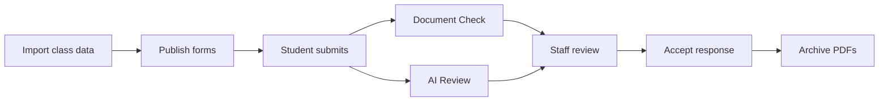

<p align="center">
  
</p>

<p align="center">
  <a href="https://www.wildtrack.dev">Open WildTrack</a> ·
  <a href="#what-you-can-do">Features</a> ·
  <a href="#quick-start-on-windows">Local setup</a> ·
  <a href="#deployment">Deployment</a>
</p>

WildTrack keeps capstone class records, submissions, adviser reviews and accepted PDF copies in one workspace. Students submit through shared forms and track their records. Advisers review assigned teams. Administrators manage class data, forms, templates and final archives.

The hosted app at [www.wildtrack.dev](https://www.wildtrack.dev) is used for supervised evaluation. Access depends on your account, role and class record.

## What you can do

| Page | What it does |
|---|---|
| Today's work | Find PDF changes, access problems, identity conflicts and records needing a staff action. Acknowledging a PDF content change dismisses its matching work item. |
| Forms | Build and publish deliverable forms. Copy readable share links with a random access token. |
| Review | View all deliverables or one deliverable, sort columns, inspect submission history and run Document Check or AI Review. Accept responses or revoke acceptance individually or through confirmed bulk actions. |
| My advised teams | Review assigned teams' outputs. An Admin preview of another adviser's teams is read-only. |
| Tracker | See class-record values and current submissions together. Sort columns to find students and outstanding deliverables. |
| Academic data | Edit Students, Teams / Projects and Deliverables. Search as you type, sort columns and source rows, paste spreadsheet cells, undo/redo edits and export CSV or XLSX. |
| Workspace | Import class data, manage staff access, upload official templates, approve Review checklists and configure Deadline PDF monitoring. |
| Archive | Prepare accepted finals, preserve PDF copies, verify integrity and unarchive records. Inactive history keeps earlier archive records available. |
| Student dashboard | View your own submissions and their status after connecting your Google account to your class record. |

### From class setup to final archive



Staff choose when to run AI Review and make the acceptance decision. File checks and AI feedback remain available alongside the submission.

## Document Check and AI Review

| | Document Check | AI Review |
|---|---|---|
| Purpose | Check access, PDF readability, template headings and whether a file looks filled beyond the template. | Assess the submitted content against deliverable instructions and the approved Review checklist. |
| Template | Uses detected template headings and content where available. | Uses the approved checklist and Template PDF. |
| Result | File and content indicators such as **Looks filled** or **Needs attention**. | A document overview, short assessments, supporting references and **No issues** or **Needs attention**. |
| Approval | Checklist approval is not required. | An administrator approves the checklist before AI Review uses it. |

Neither result grades or accepts a submission. **No issues** means the AI retained no concerns in the checked areas; staff still review the output. Technical states such as **Not reviewed** and **Retry required** are separate from completed review outcomes.

### Prepare the template once

In **Workspace → Official templates**, upload a Template PDF and select **Prepare AI drafts**. Inspect the Review checklist beside the PDF, edit it as needed, then select **Approve checklist**. Drafts can be prepared in a batch, rerun, approved or unapproved.

The approved instructions stay fixed across student reviews. Editing and saving a checklist requires approval again. Template preparation and student AI Review are separate operations.

### Assessments and supporting references

Gemini decides whether an instruction appears addressed or needs attention. WildTrack locates supporting references separately:

- **PDF text:** exact or normalized matches show the located passage and page. Conservative approximate matches show actual PDF text labelled **Closest matching text**.
- **Page breaks:** a continuous passage spanning adjacent pages can appear as one excerpt with a page range.
- **Visual evidence:** diagrams and text inside images can be labelled **AI visual observation** with a page reference. OCR is deferred.
- **Unmatched text:** Review notes can show what Gemini supplied, clearly labelled as text WildTrack could not locate.

A quotation match locates words; it does not validate Gemini's interpretation. A failed match does not change Gemini's checklist category. The report includes a document overview for blank and unexpected documents too.

### Batches, limits and retries

**AI review all** starts with a precheck of current PDFs and saved reviews. The precheck sends no Gemini request. Confirm the review scope separately before generation starts.

Precheck and review progress are saved on the server. Closing the dialog or leaving the page does not cancel the batch. **Stop after current document** finishes the ongoing document before stopping unstarted work. A failed document does not stop the rest of the batch. Failed reviews can be selected for retry separately from completed reviews needing attention.

WildTrack counts input tokens and paces requests against a shared budget. Explicit temporary quota rejections receive bounded automatic waits and retries. Daily quota exhaustion, exhausted retries and uncertain request outcomes remain visible for staff action. Provider availability and project quotas can still prevent a review. Saved results survive failed later attempts.

## Accounts, imports and monitoring

Students sign in with Google and connect through a shared form or the account connection page. Unconnected students enter their class details; they cannot browse a public roster or workspace directory. A Student Number already bound to another account cannot be overwritten by a new claim. Administrators can inspect conflicts and disconnect a mistaken binding so the student can connect again. Submissions and history remain.

Account connection is self-declared: knowing the required class details does not independently prove identity. Shared links use random tokens, and staff access is controlled separately by role and assignments.

**Workspace** accepts public Google Sheets or one Excel workbook. Download the Excel template, fill the required Student Number, Student Name and Team Code columns on the Students tab, and use the optional Teams and Projects and Deliverables tabs as needed. Preview updates before applying them. Updated workbooks retain omitted rows, blank optional values, submissions, reviews, decisions and account links. Academic data edits are saved in WildTrack without updating the source Sheet.

There is one current response per Student Number, deliverable and workspace. A later submission becomes current; earlier records remain in history.

**Deadline PDF monitoring** checks selected deliverables for changed PDFs or lost access. Checks target an hourly interval, increasing to every five minutes from 24 hours before to 48 hours after the deadline in Philippine time. Checks are best effort and subject to Drive access and quotas. Monitoring does not run AI Review.

## How archiving works

**Archive accepted finals** runs a server-managed preparation check, refreshes Document Check and lists which accepted submissions are ready or need action. Confirm the ready finals to start preserving copies. You can close the dialog while preparation or copying continues; another batch cannot start while one is running.

WildTrack copies the configured PDF artifacts and retains submission answers, other links and history. Linked Google Forms, Sheets and other non-PDF content are not copied. Each preserved PDF has a storage and integrity state; a failed copy can be retried.

Unarchiving removes the record from the default archived view and keeps its copies and inactive history. You can also revoke acceptance in the unarchive confirmation. Review blocks direct revocation of an archived response and directs staff to that combined action in Archive.

Storage uses a provider interface with local and Google Drive implementations. Changing destinations requires backend configuration; using another provider requires an implementation of that interface.

## Quick start on Windows

The supported local workflow uses the PowerShell scripts in the repository root. The launcher installs missing frontend packages, builds the backend, starts both services, checks that they are ready, and writes logs.

### 1. Install the requirements

Install:

- [Git](https://git-scm.com/download/win)
- [Node.js 20 or newer](https://nodejs.org/) — npm is included
- [Java 21 or newer](https://adoptium.net/)
- [Apache Maven 3.9 or newer](https://maven.apache.org/download.cgi)
- Windows PowerShell 5.1 or PowerShell 7

Open a new PowerShell window and check each installation:

```powershell
git --version
node --version
npm --version
java --version
mvn --version
```

PostgreSQL is not required for local use. The default backend uses an H2 database stored on the computer.

### 2. Download the project

For a new copy:

```powershell
git clone https://github.com/DeonHolo/WildTrack.git
cd WildTrack
git switch main
```

For an existing copy:

```powershell
git switch main
git pull --ff-only
```

Run the remaining commands from the repository root—the folder containing `setup-local.ps1`, `run-local.ps1`, `frontend`, and `backend`.

### 3. Configure Google services once

WildTrack uses Google sign-in and a restricted Google Drive API key for Document Check. Obtain the Drive API key for the project, then run:

```powershell
.\setup-local.ps1
```

Paste the key into the hidden prompt and press Enter. The script stores the Drive key, Google Drive switch, public OAuth client ID, and Google sign-in switch in the current Windows user's environment.

The key is not written to the repository. Never commit an API key, OAuth client secret, or service-account JSON file.

If PowerShell blocks the script, allow local scripts only for the current terminal and retry:

```powershell
Set-ExecutionPolicy -Scope Process Bypass
.\setup-local.ps1
```

Run setup once for every Windows user account that runs WildTrack. Run it again if the Drive API key changes.

### Optional: enable Gemini AI Review

Run `./setup-gemini.ps1` and enter your Gemini API key in the hidden prompt, then restart WildTrack. AI Review stays disabled without a key. The existing Drive configuration must also work so the backend can read submitted PDFs.

The configured provider uses `gemini-3.5-flash-lite`, minimal thinking and an 8,192-token output ceiling per request. Long checklists are assessed in groups of up to 16 instructions, so one document can require several requests. PDF inputs use Gemini's Files API where the provider's upload path applies. Template preparation and student review are separate operations.

Saved results are reused when verified PDF content and review settings match; the same link alone is not enough. Verified snapshots can be reused for 15 minutes within an 8 MiB memory cache and a 64 MiB private temporary disk cache.

Run AI Review on a representative submission to confirm access and inspect the feedback before a larger batch. Configure production credentials on the backend, never in browser variables or committed files.

### 4. Start WildTrack

```powershell
.\run-local.ps1
```

The first start can take a few minutes because npm installs the frontend packages and Maven builds the backend. Wait for:

```text
WildTrack is ready.
```

Open the URLs printed by the launcher:

- Application: <http://127.0.0.1:5174/>
- Backend health check: <http://127.0.0.1:8080/api/health>

The terminal can be closed after the ready message. Both services run as background processes.

### 5. Try the local demo

The floating **Dev Preview** control switches between Admin, Adviser, Student, and sample-form views. It is a local demonstration control, not production authorization.

A basic workflow is:

1. Open **Workspace** and select or create an academic workspace.
2. Download and fill the Excel template in **Workspace**, or connect the Team Formation, Tracker and Software Project Monitoring Google Sheets.
3. Preview and apply the workbook, or import the source Sheets and inspect their validation summaries.
4. Generate suggested forms when Tracker deadlines are detected.
5. Open **Forms**, publish a deliverable, and copy its public form link.
6. Submit a Google Drive PDF link through the form.
7. Inspect the result in **Tracker**, **Review**, **My advised teams** and the **Student dashboard** with the appropriate role.
8. Upload an official Template PDF in **Workspace**. Prepare, inspect and approve its Review checklist before running template-based AI Review. Run Document Check separately.
9. Accept a designated sample response and archive it after configuring storage. Verify the preserved PDF, then unarchive the sample to inspect the lifecycle.

For Sheet import, the source must be public or published. For Document Check, share the PDF as **Anyone with the link — Viewer** and allow downloading.

### 6. Stop WildTrack

```powershell
.\stop-local.ps1
```

Use the stop script when possible. It closes both process trees and removes the local PID file.

<details>
<summary><strong>Commands, local data and manual startup</strong></summary>

### Everyday commands

Run these from the repository root:

| Task | Command |
|---|---|
| Start both services | `.\run-local.ps1` |
| Start without installing frontend packages | `.\run-local.ps1 -SkipInstall` |
| Use different ports | `.\run-local.ps1 -BackendPort 8081 -FrontendPort 5175` |
| Stop both services | `.\stop-local.ps1` |
| Read backend output | `Get-Content .\logs\backend.out.log -Tail 100` |
| Read backend errors | `Get-Content .\logs\backend.err.log -Tail 100` |
| Read frontend output | `Get-Content .\logs\frontend.out.log -Tail 100` |
| Read frontend errors | `Get-Content .\logs\frontend.err.log -Tail 100` |

The `logs` directory and `.wildtrack-local.pids.json` are local runtime files ignored by Git.

### Local data

The local backend stores database files under `backend/data/`. Uploaded official templates are stored under `backend/storage/templates/`. Both locations are ignored by Git.

The browser also stores the selected workspace and some UI/demo state. Two browsers can therefore show different selections while using the same backend database.

To restore the included sample workspace, open **Workspace** and select **Restore starter data**. The confirmation requires typing `RESET`.

To discard all backend data, stop WildTrack, back up anything important, then remove the contents of `backend/data/`. The database is recreated on the next start. This permanently removes local records.

### Run the services manually

The scripts are recommended. Use this two-terminal workflow when debugging one service at a time.

Terminal 1 — backend:

```powershell
cd backend
mvn spring-boot:run
```

Terminal 2 — frontend:

```powershell
cd frontend
npm install
npm run dev -- --port 5174
```

Open <http://127.0.0.1:5174/>. The frontend calls `http://127.0.0.1:8080/api` by default.

The manual workflow still needs the Google settings created by `setup-local.ps1`. If setup ran in another terminal, open new terminals so they inherit the saved Windows user environment.

</details>

## Run the checks

Backend tests:

```powershell
cd backend
mvn test
```

Frontend unit tests and production build:

```powershell
cd frontend
$env:VITE_GOOGLE_CLIENT_ID = ''
npm ci
npm test
npm run build
```

The empty client ID keeps Google Identity Services disabled during component tests. It affects only the current PowerShell process.

## Configuration reference

The local scripts configure normal development values automatically.

| Variable | Purpose | Local value |
|---|---|---|
| `VITE_API_BASE_URL` | Frontend API base URL | `http://127.0.0.1:8080/api` |
| `VITE_GOOGLE_CLIENT_ID` | Public Google OAuth client ID | Set by `setup-local.ps1` |
| `WILDTRACK_GOOGLE_CLIENT_ID` | OAuth client ID accepted by the backend | Set by `setup-local.ps1` |
| `WILDTRACK_GOOGLE_IDENTITY_ENABLED` | Enables Google ID-token verification | `true` through the launcher |
| `GEMINI_API_KEY` | Backend-only AI Review credential | Set through `setup-gemini.ps1` |
| `WILDTRACK_GEMINI_MINIMUM_INTERVAL_SECONDS` | Minimum request spacing | 15 seconds |
| `WILDTRACK_GEMINI_INPUT_TOKENS_PER_MINUTE` | Input token budget | 200,000 |
| `WILDTRACK_GEMINI_REQUESTS_PER_MINUTE` | Request budget | 12 |

Budget settings control pacing; they do not increase your API project quota.

The setup and launcher scripts also configure the backend-only Drive key, Drive integration switch, and allowed browser origins. Use the scripts instead of entering those values in a visible command.

Public Google Sheets can be imported without service-account credentials. Edits made through Academic data are saved in WildTrack; they do not write back to the source Sheet.

Archive storage is configured separately under `wildtrack.archive.storage`. Set a default destination and named destinations with type `local` or `drive`. Local storage needs a persistent directory; Drive storage needs a folder ID, OAuth client ID, client secret and refresh token. These credentials belong on the backend. Signing in to Drive in a browser does not authorize backend archive writes. See [ArchiveStorageProperties.java](backend/src/main/java/com/capvault/backend/archive/storage/ArchiveStorageProperties.java) for the configuration fields. Unarchiving keeps retained copies and history; the default Final archive view excludes inactive history.

<details>
<summary><strong>Troubleshooting</strong></summary>


### A command is not found

Close and reopen PowerShell after installing Node.js, Java, or Maven. Then repeat the version checks in [Install the requirements](#1-install-the-requirements).

### PowerShell refuses to run a script

```powershell
Set-ExecutionPolicy -Scope Process Bypass
```

This changes the policy only for the current terminal.

### Google setup is missing

If the launcher reports that the Drive key or Google sign-in is not configured, run:

```powershell
.\setup-local.ps1
```

### Port 8080 or 5174 is already in use

First stop an earlier WildTrack session:

```powershell
.\stop-local.ps1
```

If another application owns the port, choose unused ports:

```powershell
.\run-local.ps1 -BackendPort 8081 -FrontendPort 5175
```

Use the application URL printed by the launcher.

### A service does not become ready

Read the error logs:

```powershell
Get-Content .\logs\backend.err.log -Tail 100
Get-Content .\logs\frontend.err.log -Tail 100
```

Also check <http://127.0.0.1:8080/api/health>. The launcher stops both services if either readiness check times out.

### Frontend packages are missing or damaged

```powershell
cd frontend
npm install
cd ..
.\run-local.ps1
```

### A student cannot connect their account

1. Confirm that the intended student is in the workspace roster imported through a workbook or Team Formation Sheet.
2. Check the Student Number, name and Team Code against that record. Unconnected students enter their details rather than browsing classmates' records.
3. Check for an existing binding to another Google account in **Today's work** account management.
4. For first-time form access, use the share link copied from **Forms**.

### Google Sheet import fails

- Confirm that the Sheet is public or published.
- Paste the normal Google Sheets URL or published URL into the matching source field.
- Import each Google Sheet into its matching source. For a single-file import, use the Excel template instead.
- Check the backend error log for the exact validation or network error.

### Document Check reports “Not checked” or cannot open a PDF

- Confirm that `setup-local.ps1` completed successfully.
- Confirm that the URL points to a Google Drive file, not a folder.
- Share the PDF as **Anyone with the link — Viewer**.
- Allow viewers to download the file.
- Confirm that it is a readable, non-password-protected PDF no larger than 25 MB.

</details>

## Deployment

Configure the backend Drive, Gemini and archive credentials when setting up another deployment.

The frontend is deployed on Vercel and the backend on Heroku with PostgreSQL. Follow the [deployment runbook](docs/deployment/deployment-runbook.md), check the configuration in [application-production.yml](backend/src/main/resources/application-production.yml), and use the [operations runbook](docs/deployment/operations-runbook.md) for recovery procedures. Review the current code and required credentials when using older deployment notes.

Archive storage supports local and Google Drive destinations through a provider interface. A hosted deployment needs persistent storage or a configured Drive destination; a Heroku dyno's temporary filesystem is not an archive destination. Provider availability, quotas and configured credentials affect file access and AI Review. Technical checks and saved reviews do not substitute for final user-validation evidence.

## Repository layout

- `frontend/` — React 18, Vite and Mantine interface; component and browser tests.
- `backend/` — Java 21 and Spring Boot API, persistence, migrations and integrations.
- `docs/` — requirements, design notes, and workflow specifications.
- `design-system/` — interface rules and visual guidance.
- `legacy/` — previous implementation kept for reference only.

Current WildTrack development belongs in `frontend/` and `backend/`, not `legacy/`.

For product and interface decisions, start with:

- [`docs/WildTrack_UI_Rebrand_Specification.md`](docs/WildTrack_UI_Rebrand_Specification.md)
- [`docs/WildTrack_Student_Identity_Dashboard_And_Form_Design.md`](docs/WildTrack_Student_Identity_Dashboard_And_Form_Design.md)

The [backend workflow checks](.github/workflows/academic-workflow-checks.yml), [AI Review checks](.github/workflows/ai-review-coverage.yml) and [frontend checks](.github/workflows/frontend-checks.yml) define the automated CI runs. Dated technical results remain separate from final stakeholder validation.
